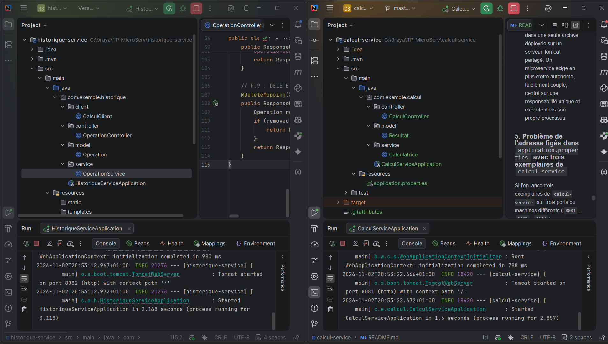
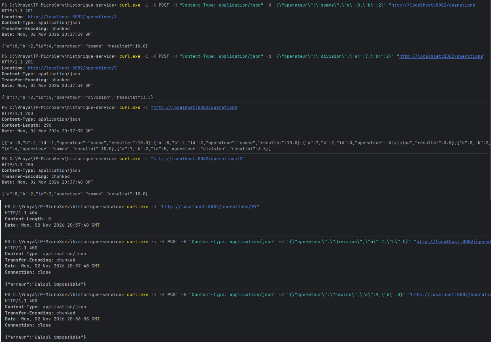
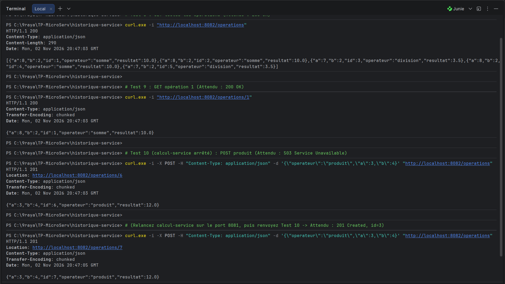
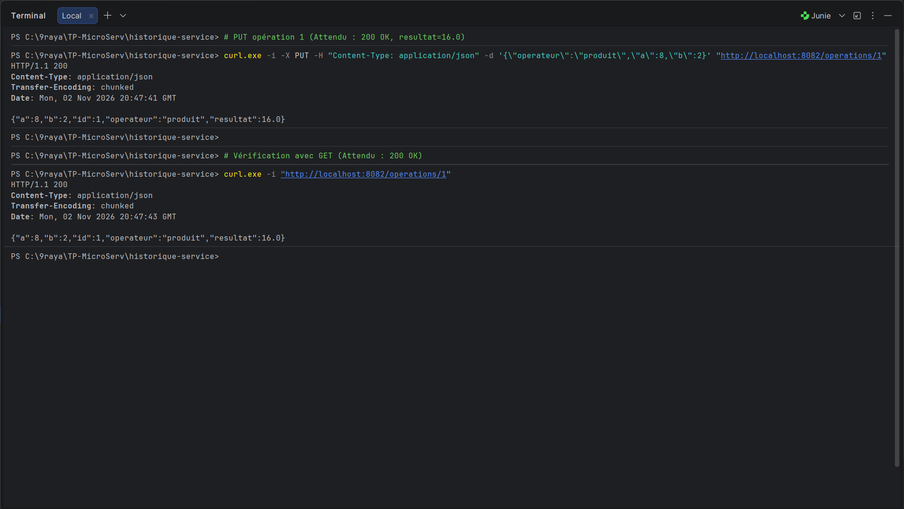
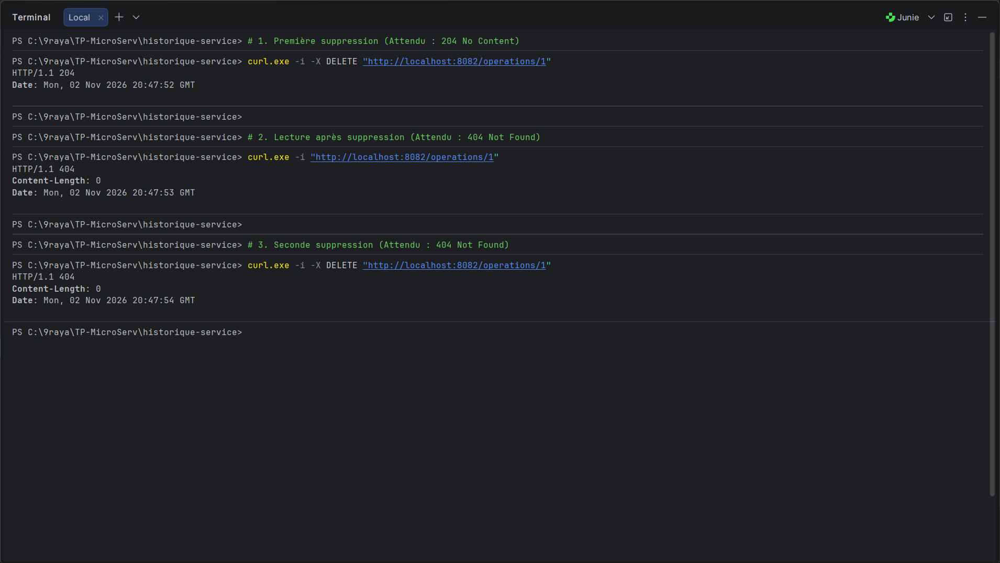

L'application est découpée en deux microservices Spring Boot autonomes disposant chacun de leur propre serveur Tomcat embarqué :
* **`calcul-service`** écoute sur le port **`8081`**.
* **`historique-service`** écoute sur le port **`8082`** et communique avec `calcul-service` via HTTP (`RestClient`).


*Figure 1 : Démarrage simultané de `calcul-service` (port 8081) et `historique-service` (port 8082).*

---

## 2. Partie A : Du service web au microservice (Questions A.4)

**1. Dans le TP2, le résultat d'une opération était calculé par un simple appel de méthode. Dans ce TP, il est obtenu par une requête HTTP vers un autre microservice. Citez un avantage et un inconvénient de ce choix.**
* **Avantage :** Découplage et indépendance totale : chaque microservice (`calcul-service` et `historique-service`) peut être développé, déployé, mis à jour ou répliqué (scalabilité) indépendamment sans arrêter l'autre.
* **Inconvénient :** Latence réseau (un appel HTTP est beaucoup plus lent qu'un appel de méthode en mémoire) et risque de panne réseau ou d'indisponibilité du service distant.

**2. Si `calcul-service` est arrêté, quelles requêtes du tableau A.2 continuent de fonctionner ? Lesquelles échouent ?**
* **Continuent de fonctionner :** `GET :8082/operations`, `GET :8082/operations/{id}`, et `DELETE :8082/operations/{id}` car elles accèdent uniquement aux données stockées en mémoire dans `historique-service` sans avoir besoin de calculer.
* **Échouent :** Toutes les requêtes directes vers `:8081/calcul/...` (serveur éteint), ainsi que `POST :8082/operations` et `PUT :8082/operations/{id}` car `historique-service` doit appeler `calcul-service` pour effectuer le calcul.

**3. Pourquoi les deux microservices ne peuvent-ils pas écouter sur le même port ?**
Sur une même machine (même adresse IP `localhost`), un port TCP ne peut être attribué qu'à un seul processus serveur à la fois ; si le second microservice tente d'écouter sur le même port, le système d'exploitation rejette la demande avec l'erreur `Port already in use`.

**4. Quel code de statut HTTP `historique-service` doit-il renvoyer quand il ne parvient pas à joindre `calcul-service` ?**
Il doit renvoyer le code **`503 Service Unavailable`** (Service indisponible) ou **`502 Bad Gateway`**, qui indique dans la famille `5xx` que le serveur ne peut pas traiter la requête temporairement à cause de l'indisponibilité d'un service en amont dont il dépend.

---

## 3. Partie C : Premier microservice (Tableaux & Questions C.1, C.2)

### Tableau C.2 : Correspondance entre Spring (TP3) et JAX-RS (TP2)

| Spring (TP3) | JAX-RS (TP2) | Rôle dans cet exemple |
| :--- | :--- | :--- |
| `@RestController` | *(pas d'équivalent direct)* | Déclare la classe comme contrôleur REST dont les méthodes renvoient directement les données dans le corps de la réponse HTTP. |
| `@RequestMapping("/calcul")` | `@Path("/calcul")` sur la classe | Définit le préfixe d'URI `/calcul` commun à toutes les méthodes du contrôleur. |
| `@GetMapping("/somme")` | `@GET` + `@Path("/somme")` | Associe la méthode aux requêtes HTTP `GET` sur le chemin `/calcul/somme`. |
| `produces = MediaType.TEXT_PLAIN_VALUE` | `@Produces(MediaType.TEXT_PLAIN)` | Indique que la réponse HTTP produite est au format texte brut (`text/plain`). |
| `@RequestParam("a") int a` | `@QueryParam("a") int a` | Extrait le paramètre `a` de la chaîne de requête (`?a=2`) et le convertit en `int`. |
| `ResponseEntity.ok(...)` | `Response.ok(...).build()` | Construit une réponse HTTP avec le code de statut `200 OK` contenant le résultat dans le corps. |

### Tableau C.6 : Origine des parties de l'URL `http://localhost:8081/calcul/somme?a=2&b=3`

| Partie de l'URL | Origine |
| :--- | :--- |
| `localhost:8081` | Machine locale et port fixé par `server.port=8081` dans `application.properties`. |
| `/calcul` | Annotation `@RequestMapping("/calcul")` placée sur la classe `CalculController`. |
| `/somme` | Annotation `@GetMapping(value = "/somme", ...)` placée sur la méthode `somme`. |
| `?a=2&b=3` | Paramètres de requête HTTP lus par `@RequestParam("a")` et `@RequestParam("b")`. |

**Question C.1. Comparez cette URL avec celle du TP2 (`http://localhost:8080/RestWebApp/api/calcul/somme?a=2&b=3`). Quelles parties ont disparu, et pourquoi ?**
Les parties **`/RestWebApp`** (contexte du fichier `.war`) et **`/api`** (`@ApplicationPath("/api")`) ont disparu. En effet, le serveur Tomcat embarqué de Spring Boot est dédié à un seul microservice déployé directement à la racine `'/'` du serveur, et les contrôleurs Spring MVC répondent directement à partir de `'/'` sans classe d'activation `@ApplicationPath`.

**Question C.2. Remplacez GET par POST dans Postman et renvoyez la requête. Quel code de statut obtenez-vous ? Est-ce le même qu'au TP2 ?**
On obtient le code de statut **`405 Method Not Allowed`**. Oui, c'est exactement le même statut qu'au TP2 car l'URI `/calcul/somme` existe mais n'accepte que le verbe `GET` (`@GetMapping`).

---

## 4. Partie D : Compléter la calculatrice (Questions D.1, D.2, D.3)

### Observations D.3
1. `GET /calcul/somme?a=2` (paramètre `b` absent) $\rightarrow$ Statut **`400 Bad Request`**.
2. `GET /calcul/somme?a=abc&b=3` (`a` non entier) $\rightarrow$ Statut **`400 Bad Request`**.

**Question D.1. Au TP2, JAX-RS donnait la valeur `0` à un paramètre entier absent et la méthode `somme` s'exécutait. Que fait Spring dans le même cas ? Laquelle des deux attitudes vous paraît la plus conforme à REST ?**
Par défaut, `@RequestParam` dans Spring considère le paramètre comme obligatoire (`required = true`) : s'il est absent, Spring rejette immédiatement la requête avec le code **`400 Bad Request`** sans exécuter la méthode. L'attitude de **Spring est plus conforme à REST** car elle signale explicitement au client que sa requête est incomplète au lieu d'inventer silencieusement une valeur par défaut (`0`) qui peut fausser des calculs (comme un produit ou une division par `0`).

**Question D.2. Avec curl ou Postman, Spring renvoie ses messages d'erreur sous forme d'objet JSON. Quels champs contient-il ?**
L'objet JSON d'erreur par défaut de Spring Boot contient les champs : **`timestamp`**, **`status`** (ex: `400`), **`error`** (ex: `"Bad Request"`), et **`path`** (ex: `"/calcul/somme"`).

**Question D.3. Complétez le tableau de correspondance : à quelles annotations JAX-RS correspondent `@RequestParam` et `@PathVariable` ? Laquelle utilisera-t-on pour lire l'identifiant dans `/operations/{id}` ?**
* `@RequestParam` correspond à **`@QueryParam`**.
* `@PathVariable` correspond à **`@PathParam`**.
* Pour lire l'identifiant dans `/operations/{id}`, on utilisera **`@PathVariable("id")`**.

---

## 5. Partie E : Échanger des données en JSON (Questions E.1, E.2)

**Question E.1. Au TP2, JSON-B avait produit `{"a":2,"b":3,"operation":"somme","resultat":5.0}`. Les deux textes JSON sont-ils équivalents pour un client ? Qui a effectué la conversion cette fois-ci ?**
* **Oui**, les deux textes JSON sont strictement équivalents pour tout client JSON car, selon le standard JSON, un objet est une collection **non ordonnée** de paires `clé:valeur`.
* Cette fois-ci, la conversion a été effectuée automatiquement par la bibliothèque **Jackson**, intégrée par défaut dans Spring Boot (`spring-boot-starter-webmvc`).

**Question E.2. Pourquoi la seconde requête (`Accept: application/xml`) est-elle refusée (`406 Not Acceptable`), alors que le code de la méthode ne mentionne aucun format ?**
Bien que le code ne mentionne pas `produces`, Spring Boot inclut uniquement le convertisseur JSON (**Jackson**) par défaut et ne possède aucun convertisseur XML configuré. Comme le client exige uniquement du XML (`Accept: application/xml`), Spring ne trouve aucun `HttpMessageConverter` capable de sérialiser l'objet `Resultat` en XML et renvoie **`406 Not Acceptable`**.

---

## 6. Partie F : Second microservice `historique-service` (Tests & Questions)

### F.6 Série de tests (Création et Lecture sur `:8082`)

| N° | Requête | Corps envoyé | Statut obtenu | Réponse obtenue |
| :---: | :--- | :--- | :---: | :--- |
| **1** | `POST /operations` | `{"operateur":"somme","a":8,"b":2}` | **`201 Created`** | `{"id":1,"operateur":"somme","a":8,"b":2,"resultat":10.0}` (+ en-tête `Location: .../operations/1`) |
| **2** | `POST /operations` | `{"operateur":"division","a":7,"b":2}` | **`201 Created`** | `{"id":2,"operateur":"division","a":7,"b":2,"resultat":3.5}` (+ en-tête `Location: .../operations/2`) |
| **3** | `GET /operations` | *Aucun* | **`200 OK`** | `[{"id":1,"operateur":"somme","a":8,"b":2,"resultat":10.0},{"id":2,"operateur":"division","a":7,"b":2,"resultat":3.5}]` |
| **4** | `GET /operations/2` | *Aucun* | **`200 OK`** | `{"id":2,"operateur":"division","a":7,"b":2,"resultat":3.5}` |
| **5** | `GET /operations/99` | *Aucun* | **`404 Not Found`** | *(Corps vide)* |
| **6** | `POST /operations` | `{"operateur":"division","a":7,"b":0}` | **`400 Bad Request`** | `{"erreur":"Calcul impossible"}` |
| **7** | `POST /operations` | `{"operateur":"racine","a":9,"b":0}` | **`400 Bad Request`** | `{"erreur":"Calcul impossible"}` |


*Figure 2 : Exécution des tests 1 à 7 de l'étape F.6 sur `http://localhost:8082/operations`.*

---

### F.7 Expérience : Arrêter `calcul-service`

| N° | Requête | Corps envoyé | Statut obtenu | Réponse obtenue |
| :---: | :--- | :--- | :---: | :--- |
| **8** | `GET /operations` | *Aucun* | **`200 OK`** | Tableau JSON contenant les opérations 1 et 2 |
| **9** | `GET /operations/1` | *Aucun* | **`200 OK`** | `{"id":1,"operateur":"somme","a":8,"b":2,"resultat":10.0}` |
| **10** | `POST /operations` | `{"operateur":"produit","a":3,"b":4}` | **`503 Service Unavailable`** | `{"erreur":"Service de calcul indisponible"}` |
| **10 (après relance)** | `POST /operations` | `{"operateur":"produit","a":3,"b":4}` | **`201 Created`** | `{"id":3,"operateur":"produit","a":3,"b":4,"resultat":12.0}` |


*Figure 3 : Tests 8, 9 et 10 lorsque `calcul-service` est arrêté (`503 Service Unavailable`), puis relancé (`201 Created`).*

**Question F.1. Pourquoi les lectures continuent-elles de fonctionner alors que `calcul-service` est arrêté ? Une telle situation était-elle possible au TP2 ?**
Les lectures (`GET /operations`) continuent de fonctionner car `historique-service` est un processus indépendant qui possède déjà les résultats enregistrés dans sa propre mémoire (`OperationService`) et n'a pas besoin de contacter `calcul-service` pour les lire. Au TP2, une telle situation **n'était pas possible** car tout faisait partie d'un seul monolithe `.war` déployé dans un unique serveur Tomcat : tout fonctionnait ou s'arrêtait en bloc.

**Question F.2. Pendant l'arrêt de `calcul-service`, le client a reçu une réponse `503` en moins d'une seconde. Que se serait-il passé sans le bloc `catch (ResourceAccessException e)` ?**
Sans ce bloc `catch`, l'exception `ResourceAccessException` non interceptée remonterait jusqu'à Spring Boot, qui renverrait au client un code **`500 Internal Server Error`** (faisant croire à tort à un bug interne dans `historique-service` au lieu d'indiquer clairement par un `503` que le service partenaire est temporairement injoignable).

---

### F.8 Modification d'une opération (`PUT /operations/{id}`)

| Situation | Statut | Corps de la réponse |
| :--- | :---: | :--- |
| Aucune opération ne porte cet identifiant | **`404 Not Found`** | *(Vide)* |
| Le calcul est impossible (opérateur inconnu, division par 0) | **`400 Bad Request`** | `{"erreur":"Calcul impossible"}` |
| `calcul-service` est injoignable | **`503 Service Unavailable`** | `{"erreur":"Service de calcul indisponible"}` |
| Modification réussie | **`200 OK`** | `{"id":1,"operateur":"produit","a":8,"b":2,"resultat":16.0}` |


*Figure 4 : Modification de l'opération 1 via `PUT http://localhost:8082/operations/1` (`200 OK`, résultat `16.0`).*

---

### F.9 Suppression d'une opération (`DELETE /operations/{id}`)

| Situation | Statut | Corps de la réponse |
| :--- | :---: | :--- |
| Aucune opération ne porte cet identifiant | **`404 Not Found`** | *(Vide)* |
| Suppression réussie | **`204 No Content`** | *(Vide)* |


*Figure 5 : Séquence de suppression `DELETE /operations/1` (`204 No Content`, puis `404 Not Found`, puis `404 Not Found`).*

---

## 7. Questions de Synthèse

### 1. Tableau A.3 complété avec les étapes du TP

| Aspect | Service web du TP2 | Microservice du TP3 | Étape du TP3 où la différence est observée |
| :--- | :--- | :--- | :--- |
| **Technologie** | JAX-RS (Jersey) | Spring Boot (Spring MVC) | **B.1 / B.3** (`spring-boot-starter-webmvc`) |
| **Découpage** | Une seule application `.war` | Deux applications : `calcul-service` et `historique-service` | **A.2 / F.1** |
| **Résultat de la construction** | Fichier `.war` | Fichier `.jar` exécutable | **B.1 / B.3 / C.5** |
| **Serveur** | Tomcat installé à part | Tomcat embarqué dans le `.jar` | **B.4 / C.5** |
| **Port** | `8080` partagé | Un port par microservice (`8081`, `8082`) | **C.4 / F.1** (`application.properties`) |
| **Adresse** | `.../RestWebApp/api/calcul/somme` | `http://localhost:8081/calcul/somme` | **C.6** |
| **Activation** | `RestApplication` (`@ApplicationPath`) | `*Application` (`@SpringBootApplication` + `main`) | **B.4** |
| **Ressource REST** | `@Path` | `@RestController` et `@RequestMapping` | **C.2 / F.5** |
| **Verbes HTTP** | `@GET`, `@POST`, `@PUT`, `@DELETE` | `@GetMapping`, `@PostMapping`, `@PutMapping`, `@DeleteMapping` | **C.2 / F.5 / F.8 / F.9** |
| **Paramètres** | `@QueryParam`, `@PathParam`, `@Consumes` | `@RequestParam`, `@PathVariable`, `@RequestBody` | **C.2 / D.4 / F.5** |
| **Réponse HTTP** | `Response` | `ResponseEntity` | **C.2 / D.2 / F.5** |
| **Conversion JSON** | JSON-B | Jackson | **B.3 / E.1 / E.2** |
| **Création des objets** | `new Calculatrice()`, attributs `static` | `@Service`, injection par constructeur, singleton | **C.1 / C.2 / F.4** |
| **Communication** | Appel de méthode Java | Requête HTTP via `RestClient` | **F.3 / F.6 / F.7** |

### 2. Tableau de correspondance complet entre les annotations JAX-RS (TP2) et Spring (TP3)

| Annotation JAX-RS (TP2) | Annotation Spring (TP3) | Rôle |
| :--- | :--- | :--- |
| `@ApplicationPath("/api")` | `@SpringBootApplication` | Active le framework et configure le point d'entrée de l'application. |
| `@Path("/...")` (sur classe) | `@RestController` + `@RequestMapping("/...")` | Déclare un composant REST et définit son URI de base. |
| `@GET` + `@Path("/...")` | `@GetMapping("/...")` | Traite les requêtes HTTP `GET`. |
| `@POST` | `@PostMapping` | Traite les requêtes HTTP `POST`. |
| `@PUT` + `@Path("/{id}")` | `@PutMapping("/{id}")` | Traite les requêtes HTTP `PUT`. |
| `@DELETE` + `@Path("/{id}")` | `@DeleteMapping("/{id}")` | Traite les requêtes HTTP `DELETE`. |
| `@Produces(...)` | Attribut `produces = ...` dans `@*Mapping` | Définit le format MIME produit dans la réponse HTTP. |
| `@Consumes(...)` + paramètre | `@RequestBody` | Désérialise le corps JSON de la requête entrante en objet Java. |
| `@QueryParam("a")` | `@RequestParam("a")` | Lit un paramètre dans la Query String (`?a=...`). |
| `@PathParam("id")` | `@PathVariable("id")` | Lit une variable directement dans le chemin de l'URI (`/{id}`). |

### 3. Commandes pour construire et lancer les deux microservices sans IntelliJ
Dans deux terminaux distincts :
* **Terminal 1 (`calcul-service`) :**
  ```bash
  cd calcul-service
  mvn clean package
  java -jar target/calcul-service-0.0.1-SNAPSHOT.jar
  ```
* **Terminal 2 (`historique-service`) :**
  ```bash
  cd historique-service
  mvn clean package
  java -jar target/historique-service-0.0.1-SNAPSHOT.jar
  ```

### 4. Un microservice est-il un service web ? Un service web est-il toujours un microservice ?
* **Oui, un microservice est un service web** dès lors qu'il expose ses fonctionnalités sur le réseau via le protocole HTTP/REST (comme `calcul-service` et `historique-service`).
* **Non, un service web n'est pas toujours un microservice :** au TP2, `RestWebApp.war` était un service web REST, mais c'était un **monolithe** regroupant calcul et historique dans une seule archive déployée sur un serveur Tomcat partagé. Un microservice exige en plus d'être autonome, faiblement couplé, centré sur une responsabilité unique et exécuté dans son propre processus.

### 5. Problème de l'adresse figée dans `application.properties` avec trois exemplaires de `calcul-service`
Si l'on lance trois exemplaires de `calcul-service` sur trois ports ou machines différents (`8081`, `8083`, `8084`), `historique-service` dont la propriété `calcul.service.url=http://localhost:8081` est fixe n'appellera toujours qu'un seul exemplaire (`8081`) : les deux autres ne recevront aucun trafic et si l'instance `8081` tombe en panne, `historique-service` échouera alors que deux autres instances sont disponibles. Il faudra un **annuaire de services (Service Discovery comme Eureka)** et un **équilibreur de charge (Load Balancer)** (sujet du TP4).

### 6. Principe *Stateless* et conservation de la liste des opérations dans `historique-service`
Le principe *stateless* interdit de stocker l'**état de session d'un client** en mémoire entre deux requêtes (le serveur ne retient pas « qui » est le client ni ses requêtes précédentes). En revanche, stocker la collection `/operations` relève de l'**état des ressources métier (Resource State)** gérées par le serveur, ce qui est la fonction normale d'un service REST.

### 7. Effet de la répétition : deux fois `POST /operations` vs deux fois `PUT /operations/1`
* Deux requêtes `POST /operations` identiques créent **deux ressources différentes** (`id=1` et `id=2`) : `POST` **n'est pas idempotent**.
* Deux requêtes `PUT /operations/1` identiques remplacent la même ressource `id=1` par la même valeur, laissant le serveur dans le même état qu'après un seul appel : `PUT` **est idempotent**.
* **La réponse est-elle différente de celle du TP2 ?** Non, la réponse est strictement identique car l'idempotence dépend du standard HTTP/REST et non de la technologie utilisée (JAX-RS ou Spring Boot).